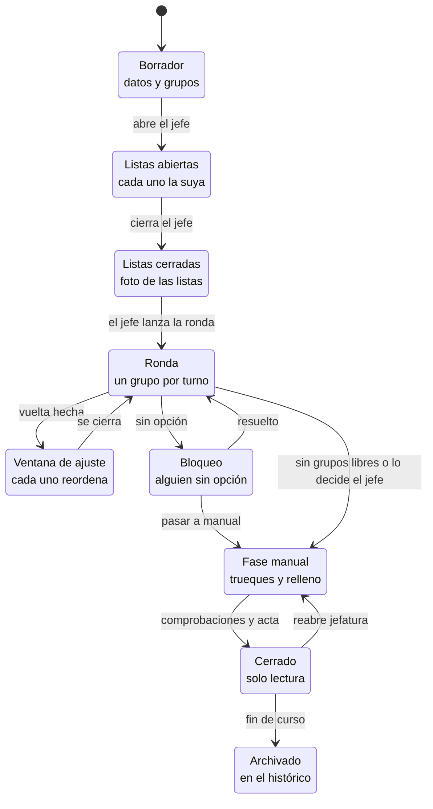
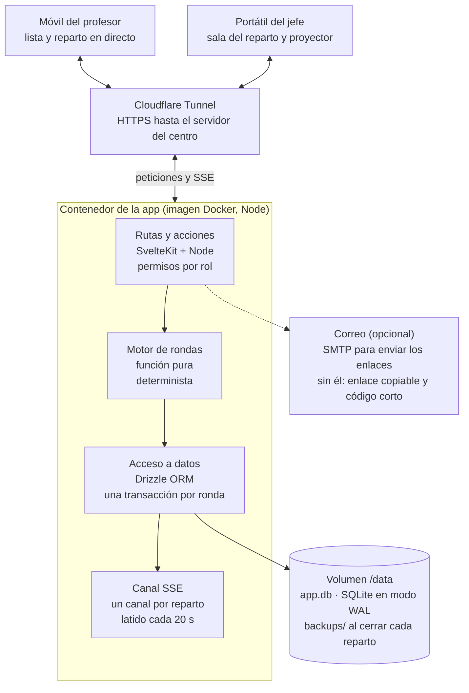

# Especificación · App de reparto de grupos («la rueda»)

*19 de noviembre de 2026 · Guzmán*

## Propósito

La app automatiza la parte obvia del reparto de grupos de cada departamento al inicio de curso y deja la parte difícil a la reunión. Produce una **propuesta**, no una imposición: lo que la app asigna sin conflicto se da por acordado y lo que se bloquea se resuelve a mano en la misma sesión.

**Para quién:** un instituto (un centro por instalación). La usan tres perfiles: jefatura de estudios (prepara el curso y el orden de elección), jefe/a de departamento (lleva el reparto de su departamento) y profesorado (prepara su lista en casa y sigue el reparto desde el móvil).

**Uso real:** dos o tres días al año. Unos días antes, cada profesor ordena los grupos que quiere; el día del reparto se ejecuta ronda a ronda en la reunión; después queda el acta y el histórico.

**Sale bien si:**

- La reunión del reparto dura bastante menos que ahora, porque las rondas sin conflicto se resuelven en segundos.
- Nadie puede decir que el resultado automático no es lo que habría salido en una rueda en vivo.
- Al terminar hay un acta imprimible lista para firmar y el reparto queda guardado para el curso siguiente.
- Un profesor sin portátil puede participar entero desde el móvil.

## Marco normativo

La referencia es la [Orden de 29 de junio de 1994](https://stecyl.net/wp-content/uploads/2023/08/Orden-de-29-de-junio-de-1994-por-la-que-se-aprueban-las-instrucciones-que-regulan-la-organizacion-y-funcionamiento-de-los-Institutos-de-Educacion-Secundaria.pdf) (instrucciones 91–98, modificadas por la Orden ECD/3388/2003), que [CSIF Castilla y León](https://www.csif.es/es/articulo/castillayleon/educacion/30563) sigue citando como norma de elección de grupos. Antes de usar la app en serio, conviene que jefatura confirme que no hay instrucciones autonómicas posteriores que la sustituyan.

| Punto | Qué dice | Cómo lo recoge la app |
| --- | --- | --- |
| 92.b | Primero, acuerdo del departamento por razones pedagógicas y de especialidad. | El resultado automático es una propuesta; la fase manual registra los acuerdos. |
| 92.c | Solo sin acuerdo: rondas sucesivas, un grupo de materia y curso por ronda, hasta completar horario o agotar grupos. | El motor elige un grupo por profesor y ronda, en el orden fijado. |
| 92.d | Los grupos que no puede asumir el departamento se asignan antes a otros departamentos y no entran en el reparto. | Marca «fuera del reparto» en el grupo, con el profesor externo anotado. |
| 92.a | Con varios turnos, el turno se acuerda o elige antes que las materias. | No hay fase de turno: el turno es un dato del grupo (decisión del constructor, ver Riesgos). |
| 92.e | El exceso sobre 18 periodos lo asumen otros profesores en cursos sucesivos. | Se permite cerrar por encima o por debajo de las horas a cubrir (exceso o defecto), visible en el cuadro de mando y registrado en el acta. |
| 92.g | En FP, preferencia para titulares de la especialidad con formación o experiencia en esos módulos. | No es automatizable; lo decide el jefe en la fase manual y queda en el acta. |
| 92.h | Quien completa horario con materia de otro departamento se incorpora a ese departamento. | Un profesor puede participar en varios repartos con horas propias en cada uno. |
| 93 | Acta de la reunión firmada por todos; copia a jefatura. | Acta imprimible generada al cerrar. |
| 95–97 | Orden: definitivos (catedráticos; luego PES y PTFP), provisionales, interinos; desempates por antigüedad. | La app **no calcula** la prelación: jefatura introduce el orden ya resuelto. |

Como jefatura entrega el orden calculado, la app guarda el orden y, como información, la situación administrativa (definitivo, provisional, interino), sin datos de antigüedad.

## Objetivos, no-objetivos y anti-objetivos

**Objetivos**

- Cada profesor prepara desde casa, en el móvil o el ordenador, una lista ordenada de los grupos que puede impartir.
- El día del reparto, la app ejecuta la rueda ronda a ronda, con pausa entre rondas para que cada uno ajuste lo que le queda.
- La parte automática se detiene en el primer bloqueo; a partir de ahí, el jefe asigna y registra trueques a mano.
- Al cerrar, se muestran las desviaciones de horas (por exceso o defecto) y los grupos sin asignar, y se genera el acta.
- Cada reparto cerrado queda en un histórico consultable y sirve de base para el curso siguiente.

**No-objetivos**

- Calcular el orden de prelación legal (lo da jefatura).
- Generar horarios semanales (es trabajo posterior de jefatura, punto 98).
- Gestionar varios centros en una misma instalación: cada centro instala su copia.
- Asignar horas complementarias, guardias o periodos del punto 94.
- Integrarse con Stilus u otros sistemas de la Junta.

**Anti-objetivos** (aunque funcione, sería un fracaso si…)

- …el resultado automático difiere de lo que habría salido en una rueda en vivo con las mismas preferencias.
- …un profesor puede ver la lista de otro y reordenar la suya para ganarle un grupo.
- …el motivo de una reducción de jornada es visible para los compañeros.
- …el jefe de departamento, que también elige, saca ventaja de ver las listas sin que quede constancia.
- …se pierden las listas entre el día que se preparan y el día del reparto.

## Enfoques considerados

**Motor del reparto: elegido «rondas con pausa y ajuste».**

| Enfoque | Qué hace | Por qué sí / no |
| --- | --- | --- |
| Cruce completo de una vez | Ejecuta toda la rueda con las listas de casa y marca conflictos al final. | Descartado: lo que viene tras el primer bloqueo depende de una decisión que aún no se ha tomado. |
| Parar en el primer bloqueo, sin pausas | Ejecuta rondas seguidas hasta el primer bloqueo. | Descartado: una lista fija no puede expresar «quiero A solo si me llevo B». |
| **Rondas con pausa y ajuste** (elegido) | El jefe lanza cada ronda; entre rondas cada uno reordena lo que le queda; se para en el primer bloqueo. | Se parece a una rueda en vivo, así que es difícil de discutir; si nadie ajusta, tarda lo mismo que sin pausas. |
| Rondas con pausa sin ajuste | Igual, pero las listas no cambian tras cerrarse. | Descartado: vuelve el problema de la lista fija. |

**Stack: elegido SvelteKit + SQLite en un contenedor.**

| Opción | Ventaja | Por qué no |
| --- | --- | --- |
| **SvelteKit + Drizzle + SQLite** (elegido) | TypeScript tipado, revisable por un programador Java; SSE sencillo con servidor Node. | — |
| Spring Boot + Thymeleaf + htmx | Java, el lenguaje del mantenedor. | El mantenedor prefirió SvelteKit. |
| Rails 8 + Hotwire | SQLite en producción y directo de serie. | Tipado dinámico, más difícil de revisar. |
| Laravel + Livewire | Muy rápido para pantallas de gestión. | El directo necesita otro proceso (Reverb). |
| PocketBase + Svelte | Login, directo y admin hechos. | Motor en JS/Go dentro de PocketBase, versión 0.x. |
| Phoenix LiveView | Directo nativo. | Elixir: casi nadie podría mantenerlo. |
| Django + htmx | Python. | El directo hay que montarlo a mano. |

## Modelo de dominio y datos

La pieza que se elige es el **grupo**: módulo o materia + grupo + turno (por ejemplo, «Bases de Datos · DAM1 · mañana · 6 h»). Cada grupo se lo lleva entero una sola persona; SMR (mañana) y SMV (tarde) son grupos distintos aunque compartan materias.

| Entidad | Campos principales | Notas |
| --- | --- | --- |
| Centro | nombre, código, localidad | Una sola fila por instalación. |
| CursoAcademico | nombre («2026-27»), estado (activo, archivado) | Agrupa los repartos de un año. |
| Departamento | nombre | Persiste entre cursos. |
| Especialidad | código, nombre | Ej.: Informática, Sistemas y Aplicaciones Informáticas. |
| Profesor | nombre, apellidos, email, especialidades (una o varias), activo | Persona; persiste entre cursos. Si tiene histórico archivado se da de baja lógica (`activo = false`) o se anonimiza. |
| Reparto | curso, departamento, jefe (profesor), estado, restringir por turno, ronda actual | Uno por departamento y curso. El cierre de listas es siempre manual por el jefe de departamento. Puede activar la restricción por turno al programarlo. |
| Participante | reparto, profesor, orden, horas a cubrir, situación (definitivo, provisional, interino), es vacante, turno (opcional), motivo de reducción (privado) | Un profesor puede participar en varios repartos (punto 92.h) con horas distintas en cada uno. |
| Grupo | reparto, enseñanza (texto libre con sugerencias: ESO, Bachillerato, FP…), curso, nombre de grupo, turno (texto libre con sugerencias: Mañana, Tarde, Diurno, Vespertino, Nocturno), materia o módulo, horas semanales, especialidades que pueden darlo (opcional), tipo (normal, relleno, fuera del reparto), profesor externo, notas | Los de 1 h se proponen como relleno por defecto; el jefe puede cambiarlo. Si no tiene especialidades asignadas, es elegible por cualquiera del departamento. |
| ExcepcionElegibilidad | participante, grupo, motivo | El jefe habilita a alguien para un grupo fuera de su especialidad. |
| Lista | participante, actualizada en | Una por participante, con guardado continuo (sin estado de borrador); al cerrar listas entra con lo que tenga guardado en ese momento. |
| ItemLista | lista, grupo, posición | Orden de preferencia. |
| Asignacion | grupo, participante, origen (ronda, manual, trueque, externo), nº de ronda, registrado por, fecha | Un grupo tiene como mucho una asignación vigente. |
| Evento | reparto, tipo, datos (JSON), actor, fecha | Registro de solo añadir; a partir de la foto de `ListasCerradas`, con él se reconstruye el reparto y se genera el acta. |
| Acceso | profesor, curso, hash del token, hash del código corto, caduca, revocado | Invitación anual por enlace personal (prioritario) y código corto para móvil, sin contraseña; válido también para usuarios de Jefatura. |
| Sesion | profesor, hash, caduca | Cookie de sesión. |

**Reglas derivadas**

- Horas restantes = horas a cubrir − suma de horas de sus asignaciones vigentes.
- Un grupo es **elegible** para un participante si existe una excepción registrada, o bien si cumple la restricción por turno (cuando esté activada en el reparto: el turno del grupo debe coincidir con el turno del participante) y el grupo no tiene especialidades asignadas o comparten alguna especialidad.
- Un grupo está **disponible** si es de tipo normal y no tiene asignación vigente.
- Las vacantes (plazas sin profesor todavía) son participantes con es vacante = sí: no hacen lista ni entran en las rondas automáticas; reciben lo que sobra en la fase manual.

## Roles, acceso y autenticación

Nadie tiene contraseña: se entra con un enlace personal (prioritario) o con un código corto en el móvil. Una misma persona puede tener varios roles.

| Rol | Quién | Puede |
| --- | --- | --- |
| Jefatura | Jefatura de estudios (uno o varios usuarios) | Crear o validar el curso, departamentos, profesores, asignaturas/grupos y repartos; fijar orden y horas a cubrir; nombrar al jefe de cada reparto; reenviar o regenerar enlaces y códigos (a profesores y a otros usuarios de Jefatura); ver todo; exportar copias. |
| Jefe de departamento | El profesor que lleva un reparto | Dar de alta y editar profesores, asignaturas/grupos y participantes de su departamento; enviar o reenviar enlaces y códigos; cerrar listas manualmente; lanzar rondas y abrir o cerrar ventanas; resolver bloqueos; fase manual; cerrar y generar el acta. |
| Profesor | Cada participante | Preparar y ajustar su lista con guardado continuo; ajustarla entre rondas; seguir el reparto en directo; ver el resultado y el acta. |

El jefe de departamento también elige en su reparto: su lista sigue las mismas reglas que las de los demás (cierre de listas, ventanas) y puede consultar las listas ajenas pulsando explícitamente «Ver lista», quedando cada consulta registrada en el acta (ver Visibilidad).

**Cómo se entra**

1. Jefatura da de alta o valida a los profesores con su correo.
2. Los repartos son anuales: cada curso el profesor necesita su invitación para acceder. Al abrir las listas, se envían los enlaces personales por correo (si hay SMTP) o se copian para repartirlos; además cada persona dispone de un código corto de 6 caracteres para facilitar el acceso desde el móvil.
3. Al abrir el enlace o introducir el código se crea una sesión (cookie) y el profesor no tiene que volver a usarlo en ese dispositivo.
4. Desde Jefatura se puede reenviar o regenerar el enlace de acceso o el código corto en cualquier momento (tanto para profesores como para otros usuarios de Jefatura).
5. Una vez cerrado el reparto, queda bloqueado en modo solo lectura mientras la aplicación permanezca activa ese curso (no sigue viva hasta el curso siguiente).

**Detalles para el constructor**

- Los tokens y códigos cortos se guardan con hash (SHA-256), nunca en claro. Las cookies de sesión son httpOnly, Secure (en HTTPS) y SameSite=Lax.
- Límite de intentos en las rutas de entrada por código.
- El servidor de correo (SMTP) es opcional y se configura por variables de entorno. Sin él, se copian los enlaces o se entrega el código corto.
- Primer arranque sin ningún usuario de jefatura: la app escribe en el log una URL de configuración de un solo uso para crear el primero.

## Ciclo de vida de un reparto

Un reparto pasa por nueve estados y el jefe provoca casi todas las transiciones; solo jefatura puede reabrir uno cerrado.



La parte automática es el bucle entre Ronda y Ventana de ajuste; un bloqueo resuelto en directo vuelve a la ronda, y cualquier otra salida lleva a la fase manual. Una vez iniciada la fase manual, se permanece en fase manual hasta el cierre (no se vuelve a rondas automáticas).

## Motor de rondas

En cada ronda, siguiendo el orden fijado por jefatura, cada participante activo se lleva el primer grupo de su lista que siga disponible, que le sea elegible y que le quepa en las horas restantes. La parte automática se para en el primer bloqueo.

**Definiciones**

- **Activo**: participante que no es vacante, tiene horas restantes y no está «pendiente de cuadrar».
- **Opción válida** de un participante: grupo de su lista, disponible, elegible y con horas ≤ sus horas restantes.
- **Pendiente de cuadrar**: le quedan horas, pero todos los grupos disponibles de su lista superan sus horas restantes. No bloquea; si en una ventana de ajuste añade un grupo disponible y elegible que le cabe en sus horas restantes, vuelve a estar **activo** para la siguiente ronda; si no, queda para la fase manual.
- **Bloqueo**: le toca a un participante activo y no tiene ninguna opción válida porque su lista se ha agotado (todo lo suyo se lo han llevado otros) o porque su lista está vacía.

**Algoritmo de una ronda**

```text
para cada participante p en orden ascendente:
    si p no está activo: continuar
    si no queda ningún grupo disponible: FIN_AUTOMATICO("sin grupos")
    opciones = [g en lista(p) si disponible(g) y elegible(p, g) y g.horas <= restantes(p)]
    si opciones vacía:
        si lista(p) tiene grupos disponibles y elegibles pero todos superan restantes(p):
            marcar p como pendiente de cuadrar; continuar
        BLOQUEO(p): detener la ronda en este turno
    asignar opciones[0] a p (origen = ronda N)
al terminar la vuelta: abrir VENTANA_DE_AJUSTE
```

**Cuando hay un bloqueo**, la app se detiene en ese turno y lo muestra a todos. Lo anterior de la ronda queda firme. El jefe elige entre:

1. **Elegir en directo**: el profesor bloqueado ve en su móvil los grupos disponibles y elegibles y escoge uno (o lo marca el jefe con él delante). Después, el jefe pulsa «continuar ronda» y se sigue por el siguiente turno. Es exactamente la rueda en vivo de la norma.
2. **Saltar el turno**: el participante queda pendiente de cuadrar y la ronda continúa.
3. **Pasar a la fase manual**: termina la parte automática.

**Ventana de ajuste (entre rondas)**

- La abre el jefe al acabar cada ronda y la cierra cuando quiere; puede poner una cuenta atrás opcional.
- Mientras está abierta, cada profesor puede reordenar, quitar o añadir grupos de entre los disponibles y elegibles (con guardado continuo). Lo que ya se han llevado otros desaparece de su lista automáticamente. Si alguien que estaba `pendiente de cuadrar` añade un grupo libre que sí le cabe en sus horas restantes, vuelve a estar `activo`.
- Quien no toca nada mantiene su lista.
- Al cerrarla se hace una foto de todas las listas y la siguiente ronda usa esa foto. Los cambios que lleguen durante la ejecución se rechazan.

**Fin de la parte automática**: el jefe pasa a la fase manual en cualquier pausa, o la app la termina sola cuando no quedan grupos normales disponibles o cuando nadie está activo. Una vez iniciada la fase manual, se sigue en fase manual hasta el cierre.

**Requisitos de implementación**

- El motor es una función pura en un módulo aparte: recibe el estado y la foto de las listas y devuelve las asignaciones y, si lo hay, el bloqueo. No toca la base de datos ni la red.
- Es determinista: con las mismas entradas da siempre la misma salida. Cada ronda se guarda como evento con la foto de entrada; a partir de la foto de `ListasCerradas`, los eventos permiten reproducir y auditar todo el reparto.
- La ejecución de una ronda va en una sola transacción. Solo el jefe puede lanzarla, y no puede haber dos ejecuciones a la vez del mismo reparto.

## Fase manual, cierre y acta

Una vez que se empieza la fase manual se continúa en ella hasta el cierre (sin volver a rondas automáticas). En la fase manual solo el jefe toca el reparto, y cada cambio queda registrado con una nota de quién lo acordó; el resto lo ve en directo en el móvil.

**Acciones del jefe**

- Asignar un grupo libre (normal o de relleno) a un participante, incluidas las vacantes.
- Mover un grupo de un participante a otro.
- Trueque: intercambiar uno o varios grupos entre dos participantes en una sola acción. Puede deshacer asignaciones de las rondas si hay acuerdo; queda en el acta.
- Desasignar un grupo (vuelve a la bandeja de libres).
- Habilitar a alguien para un grupo fuera de su especialidad (excepción con motivo, punto 92.g).
- Aceptar una desviación de horas (por exceso o por defecto, p. ej. cerrar a 17 h o 19 h sobre 18 h, o casos extraordinarios) con nota/justificación opcional para el acta (punto 92.e).
- Dos acciones de deshacer, registradas siempre como eventos de anulación (nunca como borrado):
  - **Deshacer la última acción/posición** realizada en fase manual.
  - **Deshacer la última ronda** ejecutada.

Mientras tanto, la app muestra en todo momento —tanto en el cuadro de mando del jefe como en la vista de cada profesor— las **horas con las que cierra** cada participante y su desviación respecto a sus horas a cubrir (`+1 h`, `-1 h`, `0 h`, etc.), los grupos sin asignar y los avisos de elegibilidad.

**Cierre**

| Comprobación | Si falla |
| --- | --- |
| Participantes con desviación de horas respecto a `horas a cubrir` (por exceso o defecto). | Aviso (no bloquea el cierre): se muestra la desviación y queda reflejada en el acta (con nota opcional). |
| Ningún grupo normal o de relleno queda sin asignar. | Error: se puede cerrar solo con justificación escrita, que va al acta. |
| Cada excepción de especialidad tiene motivo. | Error: no se puede cerrar. |
| Hay asistentes marcados. | Aviso. |

Tras cerrar, el reparto queda bloqueado en solo lectura. Solo jefatura puede reabrirlo, y la reapertura queda registrada.

**Acta**

Es una página imprimible en A4 que se pasa a PDF con «Imprimir → Guardar como PDF» del navegador, sin generar PDF en el servidor. Contiene, en este orden:

1. Encabezado: centro, departamento, curso, fecha, hora de inicio y fin, asistentes.
2. Orden de elección con la situación de cada participante.
3. Grupos asignados fuera del reparto (punto 92.d) y a quién.
4. Elecciones ronda a ronda: ronda, turno, profesor, grupo, horas.
5. Bloqueos y cómo se resolvieron.
6. Cambios de la fase manual, con sus notas.
7. Consultas del jefe a listas ajenas y cambios en su propia lista durante las ventanas, con hora.
8. Desviaciones de horas (exceso o defecto), excepciones de especialidad y justificaciones del cierre.
9. Resultado final por profesor: grupos, horas con las que cierra y desviación frente a las horas a cubrir (`+1 h`, `-1 h`, etc.).
10. Espacio de firma para todos los miembros (punto 93).

Además, se puede exportar el resultado final en CSV para jefatura.

## Visibilidad y privacidad

Cada lista la ven solo su dueño y el jefe de departamento; los demás solo ven lo que cada uno se ha llevado. En `Listas e invitaciones` el jefe ve solo el resumen (nº de grupos y fecha de último cambio) y, cada vez que pulsa explícitamente «Ver lista» sobre una lista ajena, queda registrado y aparece en el acta.

| Dato | Profesor | Jefe de departamento | Jefatura |
| --- | --- | --- | --- |
| Contenido de su propia lista | Sí | Sí | Sí (la suya, si participa) |
| Contenido de listas ajenas | No | Sí, solo en la pantalla Listas al pulsar «Ver lista»; cada consulta queda en el acta | No |
| Qué se ha llevado cada uno en cada ronda | Sí | Sí | Sí |
| Orden de elección y situación administrativa | Sí | Sí | Sí |
| Horas a cubrir de cada participante | Sí | Sí | Sí |
| Motivo de una reducción de jornada | Solo el suyo | Sí | Sí |
| Correos electrónicos | No | Sí | Sí |

**El riesgo de que el jefe vea las listas**: el jefe también elige y, en la ventana de ajuste, puede reordenar su lista sabiendo lo que quieren los demás. Para que eso no pase sin dejar constancia, cada consulta a una lista ajena (al pulsar «Ver lista») se registra con su hora, y lo mismo los cambios en su propia lista durante las ventanas; las dos cosas salen en el acta. Las listas ajenas nunca aparecen en la sala del reparto, que se proyecta, y por eso tampoco hay vista previa de cómo seguirían las rondas.

**Protección de datos**

- El responsable del tratamiento es el centro: antes de usarla con datos reales hace falta el visto bueno de dirección.
- Se guardan los datos mínimos: nombre, correo, especialidades, orden, horas y situación. No se guarda antigüedad ni ningún dato de salud; el motivo de reducción es un texto libre opcional, y se recomienda poner algo genérico («reducción por cargo», «reducción por otros motivos»).
- Jefatura puede anonimizar un curso archivado (sustituye nombres por «Profesor 1, 2…» y borra correos) y dar de baja lógica (`activo = false`) o anonimizar a un profesor que ya no está en el centro sin romper actas pasadas.

## Pantallas por rol

Las pantallas del profesor se diseñan primero para móvil; la sala del reparto del jefe, para portátil conectado a un proyector.

| Pantalla | Rol | Qué muestra y permite | Dispositivo |
| --- | --- | --- | --- |
| Panel del curso | Jefatura | Departamentos y estado de cada reparto; crear curso nuevo copiando el anterior. | Ordenador |
| Profesores | Jefatura | Alta, edición, validación e importación CSV; especialidades; correo; baja lógica (`activo = false`) o anonimización con histórico; reenviar o regenerar enlace/código (a profesores y a otros usuarios de Jefatura). | Ordenador |
| Configurar reparto | Jefatura / Jefe | Crear o validar participantes, orden (arrastrar), horas a cubrir, situación, motivo de reducción, vacantes, jefe del reparto (el jefe de departamento puede editar los de su departamento). | Ordenador |
| Grupos | Jefatura / Jefe | Alta, validación, edición, importación CSV y copia del curso anterior; tipo (normal, relleno, fuera del reparto); especialidades (opcional); total de horas del departamento frente a la suma de horas a cubrir. | Ordenador |
| Listas e invitaciones | Jefe | Resumen de cada lista (nº de grupos y última edición) con botón explícito «Ver lista» auditado en el acta (nunca en la sala proyectada); enviar, reenviar o copiar enlaces y código corto; botón manual para cerrar listas. | Ordenador |
| Sala del reparto | Jefe | Ronda actual, quién se ha llevado qué, horas con las que cierra cada uno y su desviación (`+1 h`, `-1 h`, etc.); botones para lanzar ronda, abrir o cerrar ventana, resolver bloqueo y pasar a manual. | Portátil + proyector |
| Fase manual | Jefe | Tablero con una columna por participante (mostrando horas con las que cierra y desviación) y una bandeja de grupos libres; acciones de la fase manual; botones de deshacer última acción/posición y deshacer última ronda; avisos en directo. | Portátil + proyector |
| Cierre y acta | Jefe | Comprobaciones (admitiendo desviación de horas con aviso), justificaciones, asistentes, acta imprimible, exportar CSV. | Ordenador |
| Mi lista | Profesor | Grupos que puede elegir, con filtros por enseñanza y turno; ordenar arrastrando o con flechas; horas que sumarían sus primeros grupos; guardado continuo sin borrador. | Móvil |
| Reparto en directo | Profesor | Ronda en curso, lo que ha conseguido, horas con las que cerraría y desviación, ventana abierta con cuenta atrás; aviso «te toca elegir» si se bloquea en su turno. | Móvil |
| Resultado | Profesor | Su reparto final (grupos, horas con las que cierra y desviación) y el acta (solo lectura). | Móvil |

**Comprobación previa útil en Grupos**: si la suma de horas de los grupos no coincide con la suma de horas a cubrir de los participantes, la app avisa antes de abrir las listas de la desviación total prevista.

## Arquitectura técnica

Un único proceso Node con SvelteKit sirve las páginas, ejecuta el motor y envía los cambios en directo por SSE; la base de datos es un archivo SQLite en un volumen.



**Piezas** (versiones estables actuales al empezar; comprobar en la documentación oficial)

| Pieza | Elección | Nota |
| --- | --- | --- |
| Framework | SvelteKit con Svelte 5 y `adapter-node` | Necesita proceso persistente: no vale Vercel ni Netlify. |
| Lenguaje | TypeScript en modo estricto | |
| Base de datos | SQLite con `better-sqlite3`, modo WAL | Un solo proceso escribe; sobra para este uso. |
| ORM y migraciones | Drizzle ORM + drizzle-kit | Migraciones al arrancar. |
| Validación | Zod en todas las acciones de formulario y endpoints | |
| Estilos | Tailwind CSS | Pensado primero para móvil. |
| Ordenar listas | Arrastrar y soltar (por ejemplo, `svelte-dnd-action`) con botones subir/bajar como alternativa | Arrastrar en móvil falla a menudo; las flechas son imprescindibles. |
| Correo | Nodemailer | Opcional. |
| Tests | Vitest, fast-check, Playwright | |

**Tiempo real**

- Un endpoint SSE por reparto (`/reparto/[id]/stream`). El servidor guarda en memoria quién escucha cada reparto; con un solo proceso no hace falta Redis.
- Cada cambio de estado incrementa un número de versión del reparto. El evento SSE lleva el tipo y la versión; si el cliente detecta un salto, pide el estado completo.
- Latido cada 20 s para que el túnel no corte la conexión por inactividad. `EventSource` se reconecta solo y, al reconectar, el cliente pide el estado completo.
- Los eventos que reciba cada usuario se filtran según su rol (ver Visibilidad).

**Organización del código**

- `src/lib/motor/`: el motor, sin dependencias de SvelteKit ni de la base de datos. Es lo primero que se escribe y se prueba.
- `src/lib/server/`: acceso a datos, autenticación, correo, canal SSE.
- `src/routes/`: pantallas agrupadas por rol (`/jefatura`, `/jefe`, `/p`).

## Despliegue y operación

Una imagen Docker, un volumen con el archivo SQLite y, opcionalmente, un contenedor `cloudflared` al lado: eso es toda la instalación.

**Dónde**

| Opción | Requisitos | Riesgo |
| --- | --- | --- |
| **Servidor del instituto + Cloudflare Tunnel con nombre** (preferida) | Un dominio en Cloudflare; salida desde la red del centro por el [puerto 7844, UDP o TCP](https://developers.cloudflare.com/tunnel/troubleshooting/), no por el 443. | La red de centros de la Junta puede tener cerrado ese puerto: probar `cloudflared` desde el servidor del centro antes de comprometerse. |
| Máquina virtual de Oracle Always Free | Cuenta de Oracle; la imagen debe ser multiarquitectura (amd64 y arm64) porque [la capa gratuita es ARM, 2 OCPU y 12 GB](https://fullmetalbrackets.com/blog/oci-free-tier-breakdown). | Los datos del profesorado quedan en una cuenta personal fuera del centro. |
| PaaS gratuito tipo Render | — | **No sirve**: [el disco es efímero y el SQLite se pierde al dormirse o reiniciarse](https://render.com/docs/free). |

El túnel rápido gratuito (`trycloudflare`) no vale para uso real: la URL cambia en cada arranque y, según creo, no admite SSE; hay que comprobarlo antes de descartarlo del todo.

**Contenedor**

- Imagen multietapa sobre Node LTS (alpine o slim), multiarquitectura.
- Volumen `/data` con `app.db` (SQLite en modo WAL) y `/data/backups`.
- Variables de entorno: `ORIGIN` (URL pública, obligatoria para la protección CSRF de SvelteKit), `DATABASE_PATH`, `TZ=Europe/Madrid`, `SMTP_HOST`, `SMTP_PORT`, `SMTP_USER`, `SMTP_PASS`, `SMTP_FROM` (las de correo, opcionales).
- `docker-compose.yml` de ejemplo con la app y `cloudflared` (token del túnel por variable de entorno).
- Las migraciones de Drizzle se aplican al arrancar.
- Endpoint `/health` para el healthcheck del contenedor; logs por stdout.

**Copias de seguridad**

- Al cerrar cada reparto, copia automática en `/data/backups` con la fecha, hecha con la API de copia de SQLite (consistente aunque haya escrituras). Se conservan las 20 últimas.
- Botón «Descargar copia» para jefatura y opción de restaurar una copia.

**Operación anual**: el contenedor puede estar parado todo el año. Se arranca unos días antes del reparto, se para después y los datos siguen en el volumen.

## Histórico, importación y paso de un curso a otro

Cada curso nuevo se crea copiando el anterior, de modo que jefatura y los jefes solo corrigen lo que cambia.

**Curso nuevo desde el anterior** copia: departamentos, profesores que siguen en el centro, jefes de reparto y los grupos de cada reparto (sin asignaciones). No copia: listas, asignaciones, horas a cubrir ni orden, que cambian cada año.

**Importación CSV** (con plantilla descargable y vista previa de errores fila a fila antes de confirmar):

| Archivo | Columnas |
| --- | --- |
| Profesores | nombre, apellidos, email, especialidades (separadas por `;`) |
| Participantes de un reparto | email, orden, horas a cubrir, situación, es vacante |
| Grupos de un reparto | enseñanza, curso, grupo, turno, materia o módulo, horas, especialidades (opcional, separadas por `;`), tipo |

**Histórico**

- Lista de cursos archivados → repartos → resultado final y acta, en solo lectura.
- Consulta «qué grupos ha impartido esta persona en cursos anteriores», que sirve para aplicar la preferencia por experiencia del punto 92.g.
- Exportación CSV de cualquier reparto y copia completa de la base de datos.

## Pruebas y criterios de aceptación

El motor se prueba a fondo con tests unitarios porque es lo que tiene que ser indiscutible; el resto, con un recorrido completo en navegador móvil.

**Tests del motor (Vitest), un caso por fixture**

- Ronda sencilla: cada uno se lleva su primera opción disponible, en orden.
- Elegibilidad: un grupo de una especialidad no va a quien no la tiene, salvo excepción; un grupo sin especialidad asignada es elegible por cualquiera.
- Horas: grupo que no cabe → se salta al siguiente de la lista; si ninguno cabe → pendiente de cuadrar, sin bloquear (vuelve a activo si en una ventana añade un grupo que le cabe).
- Lista agotada → bloqueo en ese turno; lo anterior de la ronda queda firme.
- Sin lista → bloqueo.
- Continuar tras un bloqueo resuelto en directo sigue por el turno siguiente.
- Vacantes y relleno nunca entran en las rondas automáticas.
- Determinismo: la misma entrada da siempre la misma salida.
- Reproducción: reconstruir desde los eventos (a partir de la foto de `ListasCerradas`) da el mismo estado que el guardado, incluyendo deshacer última acción y deshacer última ronda.

**Propiedades (test basado en propiedades, por ejemplo con fast-check)**: con repartos aleatorios, ningún grupo se asigna dos veces y nadie supera sus horas en la fase automática.

**Recorrido completo (Playwright, viewport de móvil)**: alta de 4 profesores y 10 grupos; guardado de listas y cierre manual por el jefe; 3 rondas con un ajuste entre rondas; un bloqueo resuelto en directo; fase manual con un trueque y deshacer; cierre; acta.

**Criterios de aceptación** (los objetivos numéricos son propuesta del constructor)

- [ ] Un profesor prepara su lista desde el móvil con guardado continuo sin instrucciones.
- [ ] Tras lanzar una ronda de 15 participantes, el resultado aparece en todos los móviles en menos de 2 segundos.
- [ ] Si el contenedor se reinicia a mitad de reparto, todo vuelve al mismo punto: ronda, ventana y asignaciones.
- [ ] Un móvil que pierde la conexión y vuelve muestra el estado correcto sin recargar a mano.
- [ ] Ni la interfaz ni la API dejan a un profesor leer la lista de otro, y cada consulta del jefe a una lista ajena aparece en el acta.
- [ ] El acta impresa en A4 contiene las diez secciones y se lee bien.
- [ ] Un curso nuevo copiado del anterior está listo para abrir listas tras corregir solo lo que ha cambiado.

## Riesgos, decisiones del constructor y puntos abiertos

El mayor riesgo no es técnico: es que la red del centro no deje salir el túnel o que los correos a cuentas educa no lleguen, y ambos se comprueban antes de septiembre.

**Riesgos**

| Riesgo | Consecuencia | Mitigación |
| --- | --- | --- |
| La red del centro bloquea el puerto 7844 | No hay túnel desde el servidor del instituto | Probar `cloudflared` en junio; plan B en Oracle Always Free. |
| Los correos con el enlace no llegan o van a spam | Profesores sin acceso para preparar su lista | Enviar una prueba a una cuenta educa con antelación; enlace copiable y código corto. |
| Un profesor llega sin móvil o sin batería | No puede ajustar ni elegir en directo | El jefe elige con él delante; la sala se proyecta. |
| Reinicio o caída a mitad de reparto | Dudas sobre el estado | Estado y eventos en la base de datos; los móviles se reconectan y piden el estado completo. |
| Las horas de los grupos no suman lo mismo que las horas a cubrir | Habrá desviación respecto a las horas a cubrir | Aviso en la pantalla Grupos antes de abrir listas; en el reparto y el acta se muestran las horas finales y desviaciones. |
| Datos personales en un servidor no aprobado | Problema de protección de datos para el centro | Visto bueno de dirección; preferir el servidor del instituto. |
| Cambia la normativa autonómica | El procedimiento deja de ajustarse | Jefatura confirma la norma vigente cada curso; el motor está aislado y es fácil de cambiar. |

**Decisiones que he tomado yo** (se pueden cambiar)

- La restricción por turno es configurable al programar cada reparto: cuando está activada, quien tiene asignado o elige un turno (p. ej. Mañana) no puede ver ni elegir asignaturas de otro turno (p. ej. Tarde), salvo excepción motivada en fase manual.
- Los grupos de 1 h son relleno por defecto: no entran en las listas y se usan en la fase manual.
- Las vacantes no hacen lista ni entran en las rondas: reciben lo que sobra en la fase manual.
- «Pendiente de cuadrar» no bloquea la ronda.
- Tras un bloqueo se puede elegir en directo y continuar la ronda, además de pasar a la fase manual.
- Las consultas del jefe a listas ajenas y sus cambios durante las ventanas quedan en el acta.
- La invitación es anual (enlace personal prioritario + código corto para móvil), se puede revocar o regenerar desde Jefatura, y al cerrar el reparto queda bloqueado en solo lectura.
- El acta es una página imprimible; el PDF lo hace el navegador.
- Una instalación por centro.
- Los objetivos numéricos de las pruebas.

**Puntos abiertos**

- [ ] Jefatura confirma que la Orden de 1994 sigue siendo la norma aplicable en Castilla y León.
- [ ] Elegir y registrar el dominio para el túnel.
- [ ] Comprobar si el túnel rápido de Cloudflare admite SSE (solo para pruebas).
